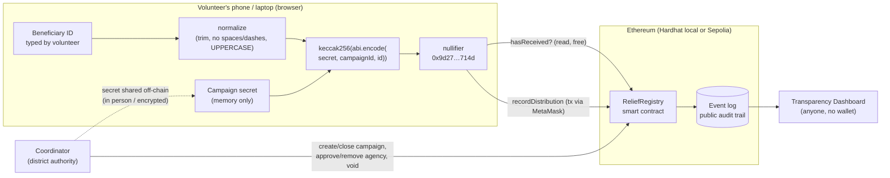
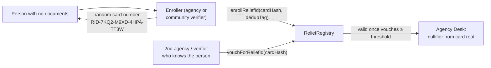

# ReliefChain: duplicate-free disaster relief

ReliefChain is a shared, tamper-proof registry for aid agencies. It answers one question:

> **"Has this person already received this type of aid in this campaign?"**

Agencies get the answer without anyone seeing a name or an ID number, and without any agency handing its beneficiary list to another.

- **Smart contract:** Solidity 0.8.30, Hardhat 2, OpenZeppelin 5 `AccessControl`
- **Frontend:** React 19, Vite 8, TypeScript, ethers v6, MetaMask, Recharts
- **Results:** 40 tests passing, 100% line and branch coverage, and batching saves 51–58% gas from 10 records up

---

## 1. Problem

After a flood or earthquake, many NGOs and government agencies distribute aid at the same time, in the same area. They can't share their beneficiary lists, because those lists hold personal data of vulnerable people. As a result:

- some families collect the same food kit from three different agencies;
- others get nothing, because the stock ran out;
- nobody can show donors an honest, auditable count.

ReliefChain gives all approved agencies one shared registry that holds **no personal data at all**: only one-way hashes ("nullifiers"), aid types, agencies and timestamps.

Many disaster-affected people have **no government ID at all**, because their documents were lost in the disaster or they never had any. For them ReliefChain issues a **Relief ID**: a random card number that the community vouches for on-chain (see [section 4a](#4a-relief-ids-for-people-without-any-government-id)).

## 2. Architecture



| Part | Where | What it does |
|---|---|---|
| [`contracts/ReliefRegistry.sol`](contracts/ReliefRegistry.sol) | Blockchain | Roles, campaigns, duplicate check, batch recording, voiding, counts, events |
| [`shared/nullifier.ts`](shared/nullifier.ts) | Browser + tests + scripts | ID normalization and nullifier hashing (one file, used everywhere) |
| [`shared/reliefId.ts`](shared/reliefId.ts) | Browser + tests + scripts | Relief ID card numbers, card hashes and the duplicate-enrollment tag |
| [`frontend/`](frontend/) | Browser | Agency Desk, Coordinator Panel, Transparency Dashboard, About |
| [`scripts/`](scripts/) | Node | Deploy, seed demo data, gas comparison, one-command dev runner |
| [`test/`](test/) | Node | Contract and nullifier tests |

There is **no backend server**. The dashboard is built directly from the contract's public event log.

## 3. How nullifiers work

```
nullifier = keccak256(abi.encode(campaignSecret, campaignId, normalizedIdNumber))
```

| Ingredient | Why it is there |
|---|---|
| **normalizedIdNumber** | `" 1234-5678 "`, `"1234 5678"` and `"12345678"` must be the same person. We trim, remove spaces and dashes, and uppercase before hashing. |
| **campaignId** | The same person gets a **different** nullifier in every campaign, so nobody can link someone's aid history across disasters. |
| **campaignSecret** | A random 32-byte value, shared **off-chain** only with approved agencies. **This is essential:** ID numbers have very little entropy (an 8-digit ID has only 10⁸ = 100 million values, which a laptop can hash in minutes). Without the secret, anyone could hash every possible ID and match the results against the public nullifiers on-chain. With a 256-bit secret, that brute force is infeasible. |
| **keccak256** | A one-way hash function: easy to compute, practically impossible to reverse. It is also the hash Solidity uses natively. |
| **abi.encode** | Unambiguous encoding of the three values (unlike `abi.encodePacked`, it can't produce collisions between different inputs). A test proves the TypeScript and Solidity versions produce identical hashes. |

**What never leaves the device:** the ID number and the campaign secret. The app keeps them only in React state (memory). It never writes them to `localStorage`, cookies, the URL or logs, and they disappear when the tab closes. The inputs set `autocomplete="off"`, so the browser doesn't remember typed IDs.

**What goes on-chain:** `campaignId`, `nullifier`, `aidType`, the agency's address and a timestamp. The Agency Desk shows this in a "What goes on-chain" panel so the audience can see it.

## 4. The smart contract

`ReliefRegistry` ([source](contracts/ReliefRegistry.sol)) is deliberately small: no upgradeability, no tokens.

**Roles** (OpenZeppelin `AccessControl`)
- `DEFAULT_ADMIN_ROLE`: the deployer; can add or remove coordinators.
- `COORDINATOR_ROLE`: the district disaster authority. Can create and close campaigns, approve and remove agencies, and void wrong entries. Coordinators are the admin of `AGENCY_ROLE`.
- `AGENCY_ROLE`: approved NGOs. Can record distributions.

**Main functions**

| Function | Who | Notes |
|---|---|---|
| `createCampaign(name, region, start, end, aidTypes[])` | Coordinator | Aid types are `bytes32` labels such as `FOOD_KIT` |
| `closeCampaign(id)` | Coordinator | Permanent |
| `approveAgency(addr, name)` / `removeAgency(addr)` | Coordinator | Removed agencies' past records stay valid |
| `voidDistribution(id, nullifier, aidType, reason)` | Coordinator | Removes the active record (it can be re-recorded); the original stays in the event log forever |
| `recordDistribution(id, nullifier, aidType)` | Agency | Reverts with `AlreadyReceived(…, agency, timestamp)` on a duplicate |
| `recordBatch(id, nullifiers[], aidTypes[])` | Agency | All-or-nothing: a duplicate *inside* the batch reverts the whole batch |
| `hasReceived`, `getDistribution`, `getCampaign`, `getTotalsByAidType`, `totalByAidType`, `totalByAgency`, `isCampaignActive` | Anyone | Free read calls; counts only |

**Design choices worth explaining**
- One record (`agency` + `timestamp`) packs into a **single 32-byte storage slot**, which keeps recording cheap.
- **Custom errors** (e.g. `AlreadyReceived`, `CampaignIsClosed`) are cheaper than revert strings, and the frontend decodes them into plain-language messages.
- **Every state change emits an event**: `CampaignCreated`, `CampaignClosed`, `AgencyApproved`, `AgencyRemoved`, `DistributionRecorded`, `DistributionVoided`. The dashboard and audit trail are rebuilt from these events.
- `NullifierTestHelper.sol` exists only for tests. It must never be deployed or called on a real network, because calling it would send a raw ID to an RPC node.

## 4a. Relief IDs: for people without any government ID

A nullifier needs *something* that identifies the person. When there is no ID document, the blockchain itself provides the identity:



| Step | What happens | What goes on-chain |
|---|---|---|
| **1. Enroll** | An approved agency or **community verifier** (new `VERIFIER_ROLE`: village heads, health workers, teachers) generates a random 16-character card number (80 bits, Crockford base32, so it is hard to misread) and writes or prints it on a card. | `cardHash = keccak256(abi.encode("ReliefChain:ReliefID", cardNumber))` |
| **2. No double enrollment** | The enroller types the person's name, parent's name, village and estimated birth year. The browser hashes them with a registry-wide **enrollment secret** into a `dedupTag`. The contract reverts with `PossibleDuplicatePerson` if the tag already exists. Names are normalized (accents, punctuation, case and word order ignored), and only the birth **decade** is used. | `dedupTag` only; the details never leave the device |
| **3. Vouch** | The card becomes valid once `vouchThreshold` (default 2, set by coordinators) **distinct** agencies/verifiers have vouched. The enroller counts as one. Vouches count per person, not per card. | `ReliefIdVouched(card, root, voucher, count)`, signed and public |
| **4. Use** | At the Agency Desk choose **Relief ID card**. The app looks up the card, and if it is valid it computes `computeNullifier(secret, campaignId, "RID:" + root)`. Duplicate prevention then works exactly as for ID numbers. | Same nullifier as always |
| **5. Lost card** | A coordinator calls `replaceReliefId(old, new, reason)`. The new card keeps the person's **root**, and so keeps their vouches and **the same nullifier**: a replacement card can't be used to collect aid twice. The old card stops working. | `ReliefIdReplaced` |
| **Fraud** | Coordinators can `revokeReliefId(card, reason)` and `removeVerifier`. Coordinators alone may enroll with `dedupTag = 0`, for a genuinely different person whose details match someone else's. | `ReliefIdRevoked` |

The **Relief IDs** page in the app covers enrolling, printing the card, checking and vouching, plus coordinator tools (enrollment secret, verifiers, threshold, revoke and replace). All Relief ID events also appear in the Dashboard's audit feed.

## 5. Setup and run

### Prerequisites
- Node.js **20.19+ or 22.12+** (tested with 22.22)
- [MetaMask](https://metamask.io) browser extension (needed only to *record*; the dashboard works without it)

### Install (local, nothing global)
```bash
npm install                 # contract tooling
npm run frontend:install    # frontend (dev:all also does this on first run)
```

### Run everything with one command
```bash
npm run dev:all
```
This starts a local Hardhat node, deploys the contract, seeds the **"Flood Relief Demo"** campaign (3 demo agencies, 11 distributions including one batch), and starts the frontend at **http://localhost:5173**. Press Ctrl+C to stop everything.

The seed prints the demo campaign secret and writes it to `demo-secrets/localhost-campaign-1.json` (git-ignored). In the Agency Desk, click **Load secret file** and choose that file.

It also approves a demo community verifier (account #4, "Riverside Village Council"), writes an enrollment secret to `demo-secrets/localhost-enrollment.json`, and enrolls two demo Relief ID cards:
- `RID-7KQ2-M9XD-4HPA-TT3W`: valid, and has already received a food kit
- `RID-3NFB-W8RC-6YJE-2DQK`: waiting for a second vouch (vouch as account #2 or #4 on the Relief IDs page)

### MetaMask for the local network
1. MetaMask → *Add network manually*: name `Hardhat Local`, RPC URL `http://127.0.0.1:8545`, chain ID `31337`, currency `ETH`. (Or click **Switch to Hardhat Local** in the app's wrong-network banner.)
2. Import these Hardhat **test** accounts (*Add account → Import account*). These keys are public, so never use them on a real network:

| Account | Role in the demo | Private key |
|---|---|---|
| #0 `0xf39F…2266` | Coordinator | `0xac0974bec39a17e36ba4a6b4d238ff944bacb478cbed5efcae784d7bf4f2ff80` |
| #1 `0x7099…79C8` | Sunrise Relief Trust | `0x59c6995e998f97a5a0044966f0945389dc9e86dae88c7a8412f4603b6b78690d` |
| #2 `0x3C44…93BC` | Riverbank Aid Network | `0x5de4111afa1a4b94908f83103eb1f1706367c2e68ca870fc3fb9a804cdab365a` |
| #3 `0x90F7…b906` | Community Health Volunteers | `0x7c852118294e51e653712a81e05800f419141751be58f605c371e15141b007a6` |
| #4 `0x15d3…6A65` | Riverside Village Council (community verifier) | `0x47e179ec197488593b187f80a00eb0da91f1b9d0b13f8733639f19c30a34926a` |

3. **After restarting the local node**, reset MetaMask's cached nonces: *Settings → Advanced → Clear activity tab data*. Otherwise transactions fail with a nonce error.

### Step by step (instead of `dev:all`)
```bash
npm run node            # terminal 1: local blockchain
npm run deploy:local    # terminal 2
npm run seed:local
npm run frontend:dev    # http://localhost:5173
```

### Sepolia testnet
1. `cp .env.example .env` and fill in `SEPOLIA_RPC_URL` and `PRIVATE_KEY` (a **test** wallet with Sepolia ETH from a faucet). `.env` is git-ignored.
2. `npm run deploy:sepolia`, then optionally `npm run seed:sepolia`. On Sepolia the seed approves the deployer itself as an agency, plus any addresses in `DEMO_AGENCY_ADDRESSES`.
3. Optional: `npx hardhat verify --network sepolia <address> <deployer>` (needs `ETHERSCAN_API_KEY`).
4. Start the frontend with `VITE_DEFAULT_CHAIN_ID=11155111` (see [`frontend/.env.example`](frontend/.env.example)). Transactions then show an Etherscan link.

The deploy script writes the address and ABI into `frontend/src/contracts/`, so the frontend picks up new deployments automatically.

## 6. Tests and gas

```bash
npm test               # 63 tests
npm run coverage       # solidity-coverage
npm run test:gas       # hardhat-gas-reporter table → docs/gas-report.txt
npm run gas:compare    # single vs batch comparison → docs/gas-comparison.md
```

**Test results: 63 passing, 100% coverage.**

```
File                      |  % Stmts | % Branch |  % Funcs |  % Lines |
ReliefRegistry.sol        |      100 |      100 |      100 |      100 |
```

The tests cover:
- duplicate prevention, including the same ID typed differently and duplicates from a different agency
- the same person receiving a different aid type (allowed)
- the same person in a different campaign (allowed, different hash)
- an unauthorized account
- a closed campaign
- a campaign outside its time window
- void then re-record
- a batch with a duplicate inside it, which rolls back the whole batch
- role management
- input validation
- the counts
- that the TypeScript nullifier matches Solidity's `keccak256(abi.encode(...))` exactly
- Relief IDs: enrolling, the vouch threshold, one vouch per voucher per person, the duplicate-person block, coordinator-only override, revoking, and replacing a lost card (same nullifier, so a second food kit is still blocked)
- Relief ID helpers: card format, misread-letter normalization, name normalization and dedup tags

### Gas: single records vs batch
Each row starts from a freshly deployed contract, so the comparison is fair (optimizer on, 200 runs).

| Records | n × `recordDistribution` | per record | 1 × `recordBatch` | per record | Saving |
|---:|---:|---:|---:|---:|---:|
| 1 | 101,500 | 101,500 | 102,820 | 102,820 | −1.3% |
| 5 | 370,688 | 74,137 | 211,244 | 42,248 | 43% |
| 10 | 707,176 | 70,717 | 346,762 | 34,676 | **51%** |
| 25 | 1,716,664 | 68,666 | 753,340 | 30,133 | 56% |
| 50 | 3,399,164 | 67,983 | 1,430,990 | 28,619 | **58%** |

**Why the batch is cheaper:** every transaction pays a fixed 21,000 gas base cost plus the role and campaign checks. A batch pays those once, and after the first record the counters are already "warm" in storage. For a single record the batch is slightly more expensive (array encoding overhead), so the app uses `recordDistribution` for single records.

Other costs, from the gas reporter averages: `approveAgency` ≈ 75k, `closeCampaign` ≈ 33k, `voidDistribution` ≈ 38k, `createCampaign` ≈ 171k–324k depending on the number of aid types, deployment ≈ 1.78M.

## 7. Threat model

ReliefChain is a proof of concept. These are its honest limits.

| Threat / limitation | What can happen | Mitigation in ReliefChain | What remains |
|---|---|---|---|
| **Campaign secret leaks** | Whoever has the secret can hash every possible ID and learn whether a specific known person received aid in that campaign (and when, and from which agency). | A fresh random 256-bit secret per campaign; the secret never goes on-chain or into browser storage; `campaignId` in the hash limits the damage to one campaign. | Secret distribution relies on people. Rotating a secret mid-campaign breaks duplicate detection for people already served. |
| **Malicious approved agency** | It could record fake distributions (inflating numbers or blocking real people with made-up IDs), or hand out aid without recording it. | Every record is signed by the agency's wallet and public; per-agency counts are visible; coordinators can remove agencies and void entries, with the reason logged forever. | A blockchain can't see what physically happens at a distribution point. Physical audits are still needed. |
| **People without ID documents** | Without some identifier they can't be hashed, so they can't be protected from (or checked for) duplicates. | **Relief IDs**: random card numbers, community vouching on-chain (`VERIFIER_ROLE`, `vouchThreshold`), a secret-keyed duplicate-enrollment check, and lost-card replacement that keeps the same nullifier. | Only as strong as the vouchers: colluding vouchers could create fake people (every vouch is public and signed, so it can be audited and the cards revoked). Someone who gives very different details (another name or village) can pass the duplicate check. A card can be handed to someone else; a photo on the printed card helps. If the enrollment secret leaks, whoever has it can test whether a *known* person is enrolled. |
| **ID typos and shared or fake IDs** | A typo creates a "new person"; a family sharing one ID gets one allocation. | Normalization handles spacing and case; coordinators can void mistaken entries. | The registry is only as good as the ID it is given. |
| **Coordinator is a trusted party** | A coordinator could approve fake agencies, void legitimate entries, or close a campaign early. | Every coordinator action emits a public event (who, what, why). | It is still a central role. Future: multi-signature coordinator or on-chain governance. |
| **Metadata on-chain** | Timestamps, agency addresses and aid types are public, so someone could infer activity patterns. | No names, IDs or locations are stored; nullifiers differ per campaign. | Zero-knowledge proofs could hide even this. |
| **RPC node sees queries** | The node operator sees which nullifiers are checked. | Only hashes are sent, never IDs. | A self-hosted node would avoid even this. |
| **Not solved: people never registered** | Families who never reach a distribution point are invisible to the system. | — | ReliefChain prevents *duplicates*; it does not find the people who were *missed*. That needs outreach, needs assessments and community mapping. |

### Future work
- **Zero-knowledge proofs** (e.g. Semaphore-style): an agency proves "this person is eligible and hasn't claimed" without publishing even a stable hash.
- **Offline mode**: field teams often have no connectivity. Cache campaign nullifiers on the device, queue records, and sync later (resolving conflicts with the contract's duplicate check).
- **Relief IDs as zero-knowledge credentials** (e.g. Semaphore groups): the person proves "I hold a vouched card" without the card's root ever being used as a nullifier input.
- **Multi-signature coordinators** to reduce trust in a single authority.
- A **Layer 2** network for lower fees at scale.

## 8. Project structure

```
contracts/ReliefRegistry.sol        main contract
contracts/test/NullifierTestHelper  test-only hash check (never deploy)
shared/nullifier.ts                 normalize + hash (used by tests, scripts, frontend)
shared/reliefId.ts                  Relief ID cards + duplicate-enrollment tag
test/                               contract + nullifier tests
scripts/deploy.ts                   deploy (local / Sepolia) + export ABI/address to frontend
scripts/seed.ts                     "Flood Relief Demo" campaign, 3 agencies, sample records
scripts/gasComparison.ts            single vs batch gas table
scripts/dev-all.mjs                 one-command local run
docs/                               gas reports
frontend/src/pages/                 AgencyDesk, ReliefIds, CoordinatorPanel, Dashboard, About
frontend/src/hooks/                 wallet, campaigns, roles, events, transactions
frontend/src/lib/                   chains, contract access, error decoding, event parsing
DEMO.md                             5-minute live demo script
```

## 9. Troubleshooting

| Symptom | Fix |
|---|---|
| "Can't reach Hardhat Local" banner | Start the node: `npm run dev:all` (or `npm run node`). |
| "Contract not found" banner | The node was restarted. Run `npm run deploy:local && npm run seed:local` (or restart `dev:all`). |
| MetaMask "nonce too high" / tx stuck | MetaMask → Settings → Advanced → **Clear activity tab data**. |
| "Not authorized: this wallet is not an approved agency" | Switch MetaMask to account #1, #2 or #3, or approve your account in the Coordinator panel. |
| "Wrong network" banner | Click **Switch to Hardhat Local** in the banner. |
| `dev:all` says port 8545 is busy | Another node is running. Stop it, or use the step-by-step scripts. |
